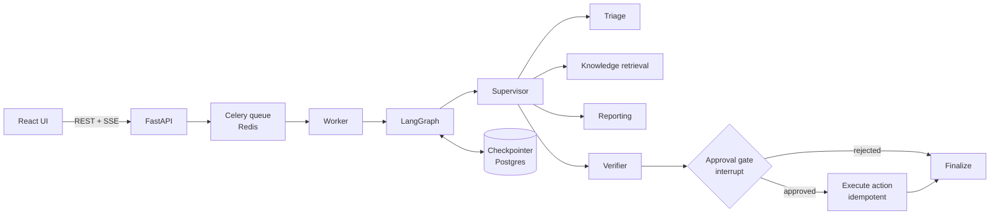

# AgentStation

**Multi-agent orchestration that survives crashes, needs a human to approve anything that changes
data, and executes each side effect exactly once.**

AgentStation runs a supervisor and scoped specialist agents over a helpdesk workload: triage,
knowledge retrieval and drafting replies. Any action that mutates an account stops at an approval
queue until a reviewer accepts, edits or rejects it. State is checkpointed durably, so a worker can
crash mid-task and another worker resumes from the last step without repeating work or firing an
action twice.

> Fictional domain: the helpdesk of **Nimbo Software** (`nimbo`) and **Atlas Retalho** (`atlas`,
> used to test tenant isolation). All data is synthetic.

## Highlights

- **LangGraph state machine.** A supervisor delegates to triage, knowledge retrieval and reporting
  agents. A verifier node checks the result before anything is finalised.
- **Human in the loop by construction.** Mutating tools sit behind an `interrupt` and an approval
  gate. Reviewers can approve, edit or reject from the UI.
- **Durable execution.** A Postgres (or SQLite) checkpointer and Celery workers. A test kills a
  real worker mid-task, and a second worker resumes it without repeating triage.
- **Exactly-once effects.** Idempotency keys on side effects. The scenario suite shows the
  multi-agent run executing 1 effect where a naive baseline executes 2.
- **Tool-injection defence.** Instructions smuggled through tool output are blocked.
- **Live visibility.** A React UI shows the graph with completed and active nodes, plus a timeline
  streamed over Server-Sent Events with `Last-Event-ID` reconnection.

## Results

Seven demo scenarios, 3 repetitions each, fake LLM provider
([`eval/results/latest.json`](eval/results/latest.json)):

| Scenario | Multi-agent | Naive baseline |
|---|---|---|
| Simple request resolved | ✅ | ✅ |
| Request split into 3 subtasks | ✅ | ✅ |
| Approval required (approved) | ✅, 1 effect | ✅, 1 effect |
| Reviewer rejects | ✅, 0 effects | ✅ |
| **Recovery after a crash** | ✅ resumes without repeating work | ❌ not supported |
| Tool injection | ✅ blocked | ✅ blocked |
| **Retry without a duplicate effect** | ✅, 1 effect | ❌ **2 effects** |

Real-infrastructure proof (2026-11-24): two real Celery workers against real PostgreSQL. The first
was killed mid-task and the second resumed without repeating triage (`1 passed in 303.64s`).

**Honest caveat:** the baseline is far faster on simple requests (about 5 ms against about 2.4 s
median), and it was written with the same rules as the scenarios. These results show durability
and correctness under failure. They don't show that multi-agent beats a workflow on real requests.
There is no real LLM, so decision quality is `TODO: measure`. The trade-off is discussed in
[`docs/learn/09-multiagente-vs-workflow.md`](docs/learn/09-multiagente-vs-workflow.md).

## Architecture



## Tech stack

Python 3.12 · FastAPI · LangGraph · Celery · Redis · PostgreSQL / SQLite · SQLAlchemy + Alembic ·
Server-Sent Events · React + Vite + React Flow · pytest (pgserver for real Postgres) · Ruff ·
Docker Compose · GitHub Actions

## Run it locally (no Docker, no API keys)

```bash
python -m venv .venv && source .venv/Scripts/activate
pip install -e ".[dev]"
export DEMO_MODE=true CELERY_EAGER=true
export DATABASE_URL=sqlite:///data/runtime/demo.db CHECKPOINT_URL=sqlite:///data/runtime/demo_cp.db
alembic -x url=$DATABASE_URL upgrade head
python -m backend.app.seed
python -m uvicorn backend.app.api.app:create_app --factory --port 18100
```

```bash
cd frontend && npm ci && npm run dev    # http://localhost:13100
```

Personas: `ines@nimbo` (requester), `rui@nimbo` (reviewer), `ada@nimbo` (admin), and `marta@atlas`
(another tenant). Try the prefilled request "classifica o ticket T-101, encontra o procedimento
aplicavel e prepara uma resposta" (classify ticket T-101, find the applicable procedure and draft a
reply) to watch three subtasks run.

**Full stack with Docker** (api, worker, postgres, redis, frontend):

```bash
docker compose up --build
```

## Quality checks

```bash
ruff check . && ruff format --check .
pytest -m "not postgres"          # fast suite (111 tests)
pytest -m postgres                # real PostgreSQL via pgserver, including crash recovery
python -m eval.runner --reps 3    # scenarios + baseline -> eval/results/latest.json
```

## Known limitations

- **Fake provider only:** no real LLM, so decision quality hasn't been measured.
- **Small sample:** the scenario suite uses 3 repetitions, so medians aren't statistically robust.
- **Open findings:** remaining items are listed in
  [`docs/security-review-independent.md`](docs/security-review-independent.md).

## Documentation

- [`docs/architecture.md`](docs/architecture.md), [`docs/decisions.md`](docs/decisions.md),
  [`docs/case-study.md`](docs/case-study.md)
- [`docs/learn/`](docs/learn/) (Portuguese): LangGraph StateGraph, supervisors and agents,
  checkpoints, interrupt and approval, exactly-once idempotency, tool authorization, memory, limits
  and cost, and multi-agent vs workflow, plus interview questions.
