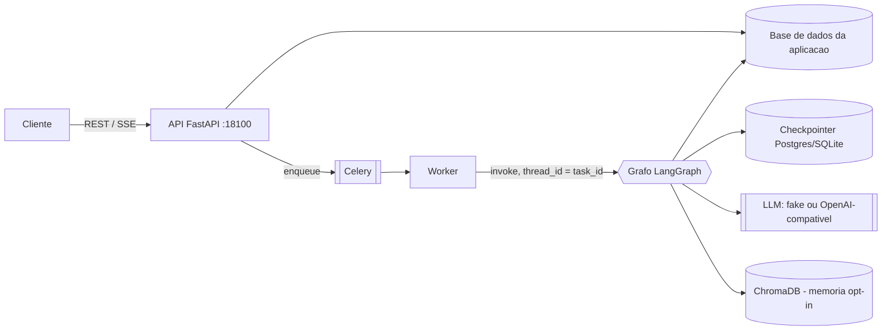

# Arquitectura

- **Grafo**: `supervisor` -> `triage` / `knowledge_retrieval` / `reporting` -> `verifier` -> `approval_gate` (interrupt) -> `execute_action` -> `finalize`. Ver `docs/learn/01`.
- **Ferramentas**: allowlist (`backend/app/tools/registry.py`), validação Pydantic, autorização com a identidade do requester, efeitos em duas fases com chave de idempotência. Ver `docs/learn/06`.
- **Aprovação**: `approvals` + `approval_audit` (só inserção). Retoma com `Command(resume=...)` lendo a decisão da base de dados. Ver `docs/learn/04`.
- **Durabilidade**: checkpoint por passo (`durability="sync"`), retoma após crash. Ver `docs/learn/03`.
- **Limites**: iterações, ferramentas, tempo, tokens e custo, verificados antes de cada chamada ao LLM. Ver `docs/learn/08`.
- **Saúde**: `/health` verifica base de dados e um heartbeat de worker (`worker_heartbeats`).
