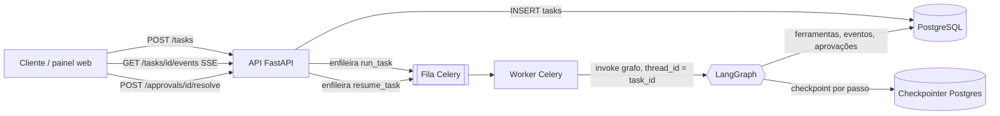
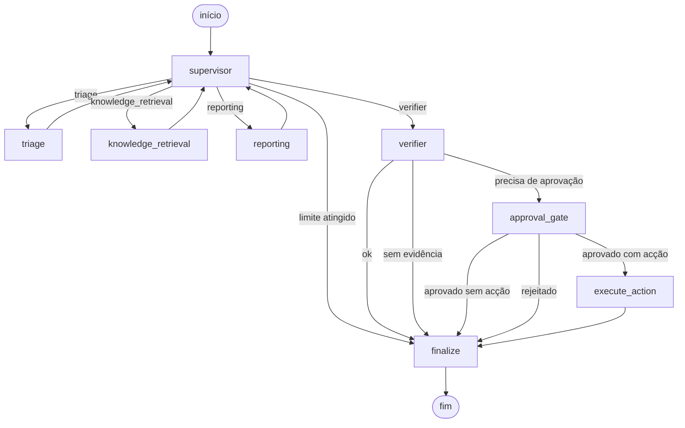

# 00 — Visão geral do AgentStation

## O problema

Uma equipa de helpdesk de TI triagem tickets, procura procedimentos e escreve respostas. Algumas acções são sensíveis (reset de MFA, suspender uma conta, mudar o estado de um ticket). Um agente LLM pode acelerar o trabalho, mas um agente que age sozinho sobre contas reais é inaceitável. Este projecto mostra três coisas:

1. Orquestração multi-agente com estado durável.
2. Aprovação humana obrigatória antes de qualquer efeito externo.
3. Execução que sobrevive a crashes sem repetir acções.

## Os processos

- **API**: cria tarefas, expõe estado, eventos (SSE), aprovações e memória. Não executa o grafo.
- **Worker**: único sítio onde o grafo corre. Se morrer, o job é reentregue (`acks_late`) e o grafo retoma do último checkpoint.
- **Base de dados da aplicação**: tarefas, eventos, aprovações, efeitos e dados demo.
- **Checkpointer**: estado do grafo por `thread_id` (= id da tarefa). A fila nunca guarda estado.

## O grafo

O supervisor escolhe o próximo nó com saída estruturada (`next` de um conjunto fechado). Os agentes só vêem as ferramentas da sua responsabilidade.

## Estado do trabalho

Este documento descreve a arquitectura planeada. Os exemplos de execução real aparecem nos documentos de cada tema, copiados da saída do código.
